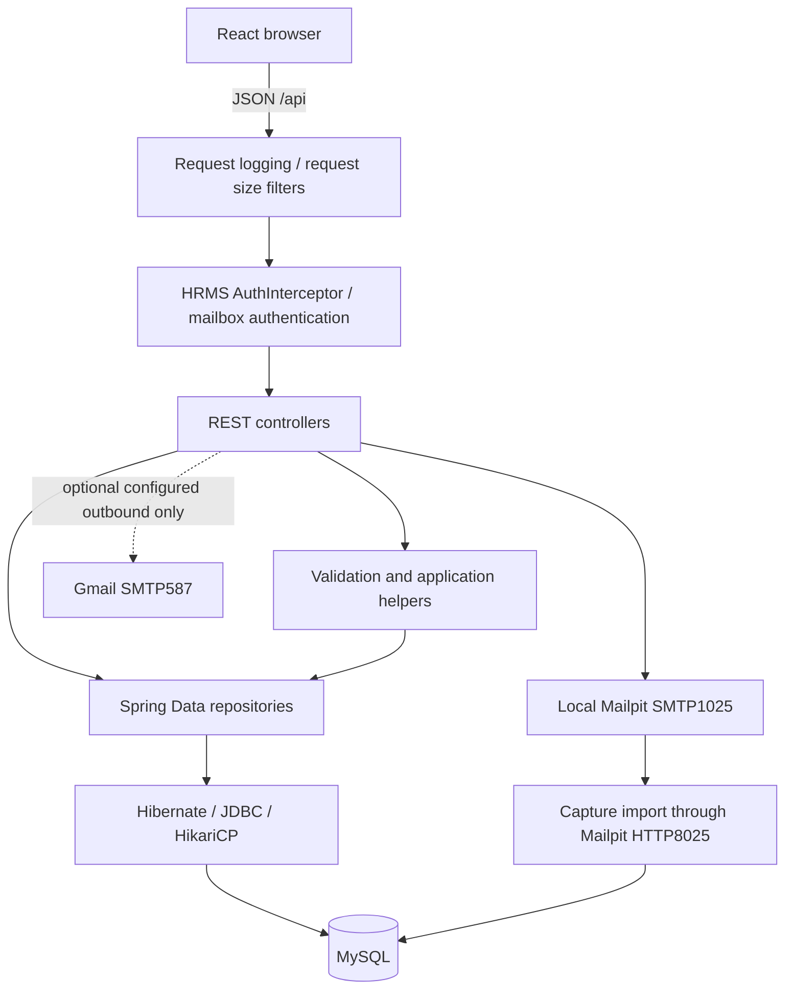

# XpertsEdge — complete backend explanation

Source reviewed: Documents/ChatGPT/HRMS/XpertsEdgeHrms, 7 November 2026. This is the latest source, not the old November5 ZIP. This reference explains every main Java file, every controller method/path route, configuration, migrations and tests. Runtime secrets/user records are excluded. No application behaviour was changed for this documentation.

## Overall architecture

One Spring Boot application (modular monolith), not separate microservices. Java17 target, Spring Boot3.3.4, Maven, Spring MVC, JPA/Hibernate, MySQL, Flyway, BCrypt, JJWT, Jakarta Mail and Actuator.



Development: Vite5173 proxies /api to backend8080. Browser / and /#/webmail open mail; /#/home opens HRMS. Hash routes are frontend navigation, not backend APIs. Production may use Nginx to serve built frontend and proxy /api; that architecture is not proof Docker/Nginx configuration has been implemented.

## Basic code terms

| Code | Meaning |
|---|---|
| @RestController | HTTP request handlers, normally JSON responses |
| @RequestMapping | Common route prefix |
| @Get/Post/Put/Patch/DeleteMapping | HTTP verb + endpoint path |
| @RequestBody | JSON body converted to Java data |
| @PathVariable / @RequestParam | ID in URL / query-string filters |
| @Service / @Component | Spring-managed dependency-injected object |
| @Entity / @Id | Database model / primary key |
| @JsonIgnore | Do not include field in API JSON |
| JpaRepository | Generated CRUD/query implementation |
| JpaSpecificationExecutor | Dynamic owner/search/filter predicates |
| @Transactional | Database changes commit/rollback together; external SMTP is not part of the DB transaction |
| @Scheduled | Background periodic worker |

Request flow: browser -> filters -> authentication/permission -> controller validation -> repository -> Hibernate/JDBC -> MySQL -> JSON response. Some controllers directly use repositories; this code does not enforce a separate service class for every module.

## Two independent login flows

HRMS: POST /api/auth/login -> AdminAuthService validates email/password/active/attempt limit -> JwtService creates auth_session + signed JWT -> HttpOnly SameSite=Strict xe_session cookie, Path=/api. Every protected request checks signature/issuer/audience/expiry, live DB session, active account and current role. Logout/password reset revoke sessions. Default60minutes, configurable1–1440. Production cookie Secure.

Webmail: POST /api/webmail/login -> mailbox BCrypt and optional authenticator/recovery -> random opaque xe_mail_session cookie, Path=/api/webmail. Only SHA-256 token hash and credential fingerprint are stored. Default1hour/browser-session cookie; Remember me30days. Mailbox reset/suspension/MFA changes revoke mail sessions. Local-mail enablement is required and local-mail+prod is refused. HRMS cookie cannot open mailbox APIs and mailbox cookie cannot open HRMS APIs.

Role rules: ADMIN accesses implemented management modules; HR_ADMIN manages employees/departments; MAIL_ADMIN manages mailbox/aliases; EMPLOYEE gets its own linked employee profile. All active HRMS accounts have own me/notifications/password/logout. Webmail ownership is a separate mailbox identity, not an HRMS role or SSO identity.

Mutating cookie requests use exact allowed Origin checks; Webmail requires Origin. AuthInterceptor also supports explicit HRMS Bearer token. CORS is not a replacement for authentication/role/owner checks. Login failures use generic credential messages. Per-account failed attempts are5per15minutes; distributed rate limiting is not implemented.

## Authoritative full endpoint index

Every source-declared method/path below is extracted from the current controllers. Prefixes are already expanded. Inputs/results are explained in the request-reference section that follows. HTTP200 is the usual success; methods annotated NO_CONTENT return204.

| Method | Full route | Source controller and line |
|---|---|---|
| POST | `/api/auth/login` | ApiController.java:56 |
| POST | `/api/auth/logout` | ApiController.java:62 |
| GET | `/api/me` | ApiController.java:67 |
| POST | `/api/auth/change-password` | ApiController.java:69 |
| GET | `/api/notifications` | ApiController.java:80 |
| GET | `/api/notifications/summary` | ApiController.java:82 |
| POST | `/api/notifications/read-all` | ApiController.java:83 |
| POST | `/api/notifications/{id}/read` | ApiController.java:85 |
| DELETE | `/api/notifications/{id}` | ApiController.java:90 |
| GET | `/api/mail/check` | ApiController.java:95 |
| GET | `/api/mail/mailboxes` | ApiController.java:96 |
| POST | `/api/mail/mailboxes` | ApiController.java:98 |
| PUT | `/api/mail/mailboxes/{id}` | ApiController.java:107 |
| POST | `/api/mail/mailboxes/{id}/reset-password` | ApiController.java:112 |
| POST | `/api/mail/mailboxes/{id}/toggle` | ApiController.java:117 |
| DELETE | `/api/mail/mailboxes/{id}` | ApiController.java:119 |
| GET | `/api/mail/aliases` | ApiController.java:125 |
| POST | `/api/mail/aliases` | ApiController.java:126 |
| PUT | `/api/mail/aliases/{id}` | ApiController.java:133 |
| DELETE | `/api/mail/aliases/{id}` | ApiController.java:142 |
| GET | `/api/hr/departments` | HrController.java:17 |
| POST | `/api/hr/departments` | HrController.java:18 |
| PUT | `/api/hr/departments/{id}` | HrController.java:19 |
| DELETE | `/api/hr/departments/{id}` | HrController.java:25 |
| GET | `/api/hr/employees` | HrController.java:26 |
| GET | `/api/hr/self` | HrController.java:27 |
| POST | `/api/hr/employees` | HrController.java:28 |
| PUT | `/api/hr/employees/{id}` | HrController.java:29 |
| DELETE | `/api/hr/employees/{id}` | HrController.java:42 |
| GET | `/api/webmail/contacts` | MailModulesController.java:15 |
| POST | `/api/webmail/contacts` | MailModulesController.java:16 |
| PUT | `/api/webmail/contacts/{id}` | MailModulesController.java:17 |
| DELETE | `/api/webmail/contacts/{id}` | MailModulesController.java:19 |
| GET | `/api/webmail/calendar` | MailModulesController.java:20 |
| POST | `/api/webmail/calendar` | MailModulesController.java:21 |
| PUT | `/api/webmail/calendar/{id}` | MailModulesController.java:22 |
| DELETE | `/api/webmail/calendar/{id}` | MailModulesController.java:24 |
| GET | `/api/webmail/preferences` | MailModulesController.java:25 |
| PUT | `/api/webmail/preferences` | MailModulesController.java:27 |
| GET | `/api/webmail/storage` | MailModulesController.java:28 |
| GET | `/api/webmail/security` | MailSecurityController.java:8 |
| POST | `/api/webmail/security/setup` | MailSecurityController.java:9 |
| POST | `/api/webmail/security/confirm` | MailSecurityController.java:10 |
| POST | `/api/webmail/security/disable` | MailSecurityController.java:11 |
| GET | `/api/org/users` | OrgController.java:21 |
| POST | `/api/org/users` | OrgController.java:22 |
| PUT | `/api/org/users/{id}` | OrgController.java:31 |
| POST | `/api/org/users/{id}/reset-password` | OrgController.java:39 |
| DELETE | `/api/org/users/{id}` | OrgController.java:43 |
| POST | `/api/webmail/login` | WebmailController.java:23 |
| GET | `/api/webmail/me` | WebmailController.java:24 |
| POST | `/api/webmail/logout` | WebmailController.java:25 |
| GET | `/api/webmail/status` | WebmailController.java:26 |
| POST | `/api/webmail/smtp/check` | WebmailController.java:27 |
| GET | `/api/webmail/messages` | WebmailController.java:30 |
| POST | `/api/webmail/drafts` | WebmailController.java:75 |
| PUT | `/api/webmail/drafts/{id}` | WebmailController.java:76 |
| POST | `/api/webmail/send` | WebmailController.java:81 |
| PATCH | `/api/webmail/messages/{id}` | WebmailController.java:102 |
| DELETE | `/api/webmail/messages/{id}` | WebmailController.java:116 |
| POST | `/api/webmail/schedule` | WebmailController.java:117 |
| POST | `/api/webmail/schedule/{id}/cancel` | WebmailController.java:118 |
| POST | `/api/webmail/bulk` | WebmailController.java:120 |
| GET | `/api/webmail/messages/{id}/attachments/{fileId}` | WebmailController.java:121 |

### Framework health routes (not custom Java controllers)

GET /actuator/health, GET /actuator/health/liveness and GET /actuator/health/readiness are supplied by Spring Boot Actuator. Liveness checks app state; readiness includes database availability. Details/components are hidden. Only health is exposed; discovery/JMX exposure is disabled.503 means unavailable/not-ready. CORS OPTIONS is handled by MVC, not an extra business controller endpoint.

## Endpoint request/response reference

The following detailed project API reference uses /api as its base prefix. Corrections to older paragraphs: /mail/check returns LOCAL_ONLY when local-mail is enabled, otherwise NOT_CONFIGURED. Local SMTP send/receive is implemented; “no message sent/received” applies to disconnected mode/external provisioning, not enabled Mailpit mode. Inbox/Sent/drafts, attachments and personal modules are persistent in MySQL. Account password-change/new-account rules are12+chars/max72bytes; mailbox password rules are8+chars/max72bytes. Login only verifies the existing password rather than requiring the new-password minimum.

# API reference

Base path `/api`. JSON request/response bodies. Requests through the frontend proxy use the same origin. Login returns an HttpOnly `xe_session` cookie, not a JSON bearer token. Send that cookie on protected requests. Mutations using cookie authentication require an allowed `Origin` header. Never send credentials to an untrusted host.

## Roles

| Role | Access |
|---|---|
| ADMIN | All implemented modules and user management |
| HR_ADMIN | Employee/department management; no Mail Admin/user management |
| MAIL_ADMIN | Local mail administration; no HR/user management |
| EMPLOYEE | Own linked employee profile only |

All authenticated users can read their own account/notifications, change their own password and sign out. Unknown/inactive accounts and revoked sessions return 401; insufficient role returns 403. Existing pre-role accounts retain their previous admin access through V4; review them before deployment.

## Authentication

| Method/path | Body | Result |
|---|---|---|
| POST `/auth/login` | `email`, `password` | `user`, `expiresIn`; sets session cookie |
| GET `/me` | — | `id,name,email,initials,role,active,employeeId` |
| POST `/auth/logout` | — | 204; revokes session and clears cookie |
| POST `/auth/change-password` | `currentPassword`, `password` | 204; revokes all account sessions |

Five failed logins per email in 15 minutes trigger 429. Account passwords require 12+ characters, at most 72 UTF-8 bytes. Deactivated users cannot sign in. Password recovery/email invitations are not implemented.

## HR — ADMIN / HR_ADMIN

| Method/path | Behavior |
|---|---|
| GET/POST `/hr/departments` | List/create departments |
| PUT/DELETE `/hr/departments/{id}` | Update/delete department; employee dependencies block deletion |
| GET/POST `/hr/employees` | List/create employees |
| PUT/DELETE `/hr/employees/{id}` | Update/delete employee; linked user blocks deletion |
| GET `/hr/self` | Any authenticated role: its own linked employee; 404 if unlinked |

Department body:

```json
{"name":"Engineering","description":"Technology team","active":true}
```

Employee body (used for create and update):

```json
{
  "employeeCode":"EMP001",
  "firstName":"Example",
  "lastName":"Employee",
  "email":"employee@example.com",
  "phone":"",
  "jobTitle":"Developer",
  "joiningDate":"2026-10-29",
  "employmentType":"FULL_TIME",
  "status":"ACTIVE",
  "departmentId":1
}
```

Types: `FULL_TIME, PART_TIME, CONTRACT, INTERN`; statuses: `ACTIVE, INACTIVE`. Department ID is optional/null; assigned departments must be active. Code normalizes to uppercase and permits letters/numbers/underscore/dash (max 32). Email normalizes to lowercase and is unique. Names/job title max 100, phone max 32. Joining date must be valid ISO date. Lists return all records; frontend search is local, not server pagination.

## Organization — ADMIN only

| Method/path | Body / behavior |
|---|---|
| GET `/org/users` | Safe account views; no passwords/hashes |
| POST `/org/users` | `name,email,password,role,active,employeeId` |
| PUT `/org/users/{id}` | `name,role,active,employeeId`; login email is immutable |
| POST `/org/users/{id}/reset-password` | `password`; revokes that user's sessions |
| DELETE `/org/users/{id}` | 204; revokes sessions, retains linked employee |

Employee link is optional but must reference an existing employee and cannot be shared by multiple accounts. Accounts and employee records are created separately. Deleting an employee requires unlinking its account first. Administrators cannot delete/deactivate/demote themselves or remove the final active administrator. Use own authenticated change-password endpoint for own password rather than administrative reset. No credential is emailed automatically.

## Local mail — ADMIN / MAIL_ADMIN

| Method/path | Body / behavior |
|---|---|
| GET `/mail/check` | Returns LOCAL_ONLY in local-mail mode; otherwise NOT_CONFIGURED; no connected internet provider |
| GET/POST `/mail/mailboxes` | List/create; `address,displayName,quotaGb,password` |
| PUT `/mail/mailboxes/{id}` | `displayName,quotaGb` |
| DELETE `/mail/mailboxes/{id}` | 204; also deletes dependent aliases |
| POST `/mail/mailboxes/{id}/reset-password` | `password`; local record only |
| POST `/mail/mailboxes/{id}/toggle` | Toggle local active flag |
| GET/POST `/mail/aliases` | List/create; `alias,target` |
| PUT `/mail/aliases/{id}` | `alias,target`; rename/retarget |
| DELETE `/mail/aliases/{id}` | 204; target mailbox remains |

Address/alias/target are local parts, not full email addresses: max 64, letters/numbers/dash/underscore, dots only between non-empty segments. Input normalizes case/outer whitespace. Mailbox and alias names share a namespace. Target must exist. Quota is an integer 1–1000 GB. Mailbox passwords: 8+ characters and max 72 UTF-8 bytes. Storage allocation/password/status are local data only. No real provider mailbox is provisioned. Enabled local-mail supports Mailpit send/receive; internet delivery remains unconfigured.

## Notifications — own account only

| Method/path | Result |
|---|---|
| GET `/notifications` | Latest 100 own notifications, newest first |
| GET `/notifications/summary` | `unreadCount` across all own notifications |
| POST `/notifications/{id}/read` | Read notification; idempotent |
| POST `/notifications/read-all` | `updated` count |
| DELETE `/notifications/{id}` | 204; dismiss own notification |

Successful local changes create notifications for the acting account; failed writes do not. Other accounts' notification IDs return 404. UI refreshes after actions/open and every 30 seconds, not push delivery.

## Health and errors

Anonymous backend paths: `/actuator/health`, `/actuator/health/liveness`, `/actuator/health/readiness`. Healthy=200; unhealthy/unready=503. Details hidden. Readiness includes DB connectivity; liveness does not.

API responses include `X-Request-ID` for support correlation. Error JSON generally contains `message` (Spring errors may also include `timestamp,status,error,path`). Statuses: 400 invalid body/dependency/self-lockout; 401 login/session; 403 role/origin; 404 missing/unowned record; 409 database uniqueness/referential conflict; 429 login lockout. Do not depend on exact wording. Runtime secrets/body/header values are not recorded by request logging.

AI endpoints have been removed. Recruitment, attendance, leave and payroll APIs are not implemented.

## Local Webmail API

Requires local-mail profile. Separate `xe_mail_session` HttpOnly SameSite Strict cookie (`/api/webmail`); HRMS and mailbox cookies do not grant each other's privileges. Mutation Origin must be allowed. Mail mutation request bodies are limited to 2 MB. API authentication and ownership remain mandatory for files.

- POST `/api/webmail/login`: `{email,password}` -> `{user}` + cookie. Five failures block that mailbox identity for 15 minutes.
- GET `/api/webmail/me`; POST `/api/webmail/logout` (204).
- GET `/api/webmail/status`: local capture state and optional Gmail authorization.
- GET `/api/webmail/messages?page=0&folder=Inbox&q=term&tag=Green`: owned results, 200 per page; returns messages, total, hasMore, folder counts, unread, connected and optional Gmail sender. Empty folder means all folders. Search covers subject/body/From/To/Cc; `%` and `_` are literal. Files are metadata only (id/name/contentType/size).
- POST `/api/webmail/drafts`; PUT `/api/webmail/drafts/{id}`. Fields: `to`, optional `cc`, `subject`, `body`, optional tag. Recipients are comma/semicolon-separated, at most 20. Body <=20,000, subject <=255. `attachments:[{name,contentType,data:<base64>}]` uploads new files; `attachmentIds:[id]` keeps existing owned draft files (omitting the property preserves existing files). Combined max 5 files/1 MB.
- For forwarding into a new draft: `forwardFromId:<owned message id>` plus optional `forwardAttachmentIds:[source-file-id]`. The server copies validated source bytes into new attachment IDs; another mailbox's source ->404. Clients cannot retain file IDs from another draft/message.
- POST `/api/webmail/send`: same draft fields plus optional saved draft `id`. UI always saves first and sends its ID. Local recipient/alias validation happens before SMTP submission. Success moves to Sent with SMTP_ACCEPTED; duplicate sent IDs ->400. SMTP failure ->502/503, with FAILED persisted on the retained draft. SMTP acceptance is not a read/delivery receipt. Internet recipients require the separate configured/authorized Gmail adapter and cannot be mixed with local recipients.
- PATCH `/api/webmail/messages/{id}`: `seen:boolean`, supported tag, `folder:"Inbox"|"Spam"|"Trash"|"Restore"`. Restore uses the previous original folder; Drafts/Sent can be trashed/restored. Inbox/Spam moves apply to received messages only.
- DELETE `/api/webmail/messages/{id}`: only Trash, permanent deletion, 204. Cascades files and records an owner-scoped capture tombstone to prevent re-import.
- GET `/api/webmail/messages/{id}/attachments/{fileId}`: authenticated owner-only attachment download; octet-stream, attachment Content-Disposition, no-store, nosniff. Cross-owner or wrong message file ID ->404.
- POST `/api/webmail/smtp/check`: optional Gmail-only SMTP authentication check; requires an allowed mailbox and configured credentials. No external email is sent by this check.

See LOCAL-MAIL.md for local security/trust boundaries, storage, startup and tests. No real domain/provider provisioning or internet receiving is implied.

## Local Webmail personal modules

All routes below use the mailbox-only `xe_mail_session` cookie and the existing same-origin mutation policy. HRMS admin cookies cannot authorize these endpoints.

| Method | `/api/webmail` route | Body / behavior |
|---|---|---|
| GET / POST | `/contacts` | List own contacts / create `{name,email,phone,company,notes}` |
| PUT / DELETE | `/contacts/{id}` | Edit own contact / delete |
| GET / POST | `/calendar` | List own events / create `{title,startsAt,endsAt,location,notes}`; ISO UTC timestamps |
| PUT / DELETE | `/calendar/{id}` | Edit own event / delete |
| GET / PUT | `/preferences` | `{signature,theme:light|dark,density:compact|comfortable,timeZone,shortcuts:boolean}` |
| GET | `/storage` | Own body/attachment bytes and folder counts |
| POST | `/schedule` | `{id,scheduledAt}`; existing draft, future ISO instant, local recipients |
| POST | `/schedule/{id}/cancel` | Move own scheduled message back to Drafts |
| POST | `/bulk` | `{ids:[...],action:read|unread|archive|trash|restore|delete}`; 1–200 IDs, atomic |
| GET | `/security` | `{enabled}` |
| POST | `/security/setup` | `{password}`; temporary authenticator key, expires in 300 seconds |
| POST | `/security/confirm` | `{password,code}`; enables 2FA, revokes sessions, returns eight recovery codes once |
| POST | `/security/disable` | `{password,code}`; authenticator or recovery code, revokes sessions |

`POST /login` additionally accepts `rememberMe:boolean` and optional `code` (TOTP or recovery code). A non-remembered cookie has no persistent Max-Age and expires server-side after one hour; remembered sessions last 30 days. Login failures use a generic credential error.

`GET /messages` additionally accepts `read=read|unread`, `after=YYYY-MM-DD`, `before=YYYY-MM-DD`, `hasAttachment=true` and `folder=Archive`. Date filters use UTC inclusive dates. PATCH folder changes also accept `Archive` for sent or received messages. Scheduled messages moved to Trash are canceled and restore as Drafts.

Contacts and calendar field lengths are enforced server-side. Cross-account IDs return 404. Security setup/change is limited to five attempts per mailbox per 15-minute window, resetting after success. Secrets and recovery codes must never be logged.


## Exact implementation behaviour and important payload details

- POST /webmail/send accepts the draft fields and optional existing draft id; it is not an API that accepts only recipient and ignores owner/state. Sent IDs cannot be normally reused.
- Draft fields: to (required text, may be empty), subject/body (required text), optional cc/tag, attachmentIds, attachments. attachmentIds must belong to that same draft. New attachments use objects {name,contentType,data}, data=Base64.
- New forward draft accepts forwardFromId and optional forwardAttachmentIds; source must be owned, copied attachments get independent records. Reply/Reply-all/Forward compose prefill is frontend logic, not extra backend /reply APIs.
- Max20unique recipients combined, subject255(no CR/LF), body20,000characters,5files/1MiB decoded total,2MiB request. To/Cc each max2000. Local/external recipients cannot mix in one send.
- GET /messages page starts0, fixed200/page, owner-only; query searches subject/body/from/to/cc (<=200characters, literal escaped %/_). Folders Inbox/Drafts/Scheduled/Sent/Spam/Trash/Archive. after/before are inclusive UTC dates. First-page fetch imports captures if Mailpit is ready.
- Response fields: messages, connected, hasMore, total, externalAllowed, senderEmail, counts, unread. No GET /messages/{id} detail endpoint exists; UI uses loaded message data plus separate attachment download.
- PATCH accepts seen:boolean, tag and/or folder. Restore only from Trash; Inbox/Spam only for received mail; Archive only eligible sent/received records. Trashing Scheduled cancels it and sets restore destination Drafts.
- Bulk checks all owner IDs before changes; outer transaction rolls back invalid-state changes too. Max200; action read/unread/archive/trash/restore/delete. Permanent deletion only from Trash.
- Contacts fields name/email/phone/company/notes should all be sent; optional-looking blank strings are accepted but omitted fields still hit text checks. Calendar similarly title/startsAt/endsAt/location/notes; end strictly after start. Contacts bounded100/254/32/100/1000; event title150/location200/notes2000.
- Preferences require signature/theme/density/timeZone/shortcuts; light or dark, compact or comfortable, valid ZoneId; signature<=2000. Storage includes UTF-8 body + attachment bytes only, excludes database/index/SMTP-capture overhead, no enforced quota.
- Own profile is GET /hr/self, not a free-form employee ID. Departments with employees cannot delete; employees linked to users must first be unlinked. User login email is immutable through current user-update API; mailbox local address is immutable through mailbox-update API.
- Notification list is newest100; summary counts all own unread. These are actor notifications, not announcements to all employees.
- Security setup returns a manual key valid5minutes; confirm returns8recovery codes once. Enabling/disabling revokes mail sessions. Current mailbox password required; confirmation/disable also requires code. A setup TOTP is consumed and cannot immediately be reused for login. Save recovery codes. Password reset does not disable MFA.
- Mail status values: DRAFT, SCHEDULED, SMTP_ACCEPTED, RECEIVED_LOCAL, FAILED. SMTP_ACCEPTED is transport acceptance, not an external delivery/read receipt.

## Every main Java source file

Files are in backend/src/main/java/com/xpertsedge/hrms. The following inventory is checked against the actual directory; no main Java file is omitted. Repository implementations are generated by Spring, not additional handwritten .java files.

### AdminAuthService.java

HRMS account login: normalize email, BCrypt check, active-account check and generic credential errors. Persists five-attempt/15-minute lockout. Password update hashes replacement and revokes all HRMS sessions. Synchronization is per JVM, not distributed.

### Alias.java

Alternate local alias name points to an existing mailbox local part. Table mail_alias, column alias_name. Created timestamp protects retargeting privacy. No separate alias password/login.

Model fields: `createdAt`, `id`, `alias`, `target`.

### AliasRepo.java

Alias CRUD and alias-name existence check.

Declared queries: `existsByAlias`. Inherited CRUD includes save/findById/findAll/delete/count.

### ApiController.java

HRMS login/logout/me/password change; own notifications; Mail Admin mailbox and alias CRUD. Uses BCrypt, namespace locking and notifications. Mailbox creation is local, not Google/provider provisioning.

### ApiErrors.java

Maps DataIntegrityViolationException to409 with safe duplicate/dependency message. Other validation/auth exceptions use Spring response handling; not a universal exception handler.

### AppNotification.java

Per-recipient title/body/read/timestamp. Recipient excluded from JSON; own-recipient repository queries isolate records.

Model fields: `id`, `recipient`, `title`, `body`, `read`, `createdAt`.

### AppUser.java

HRMS identity, role/active status and optional unique employee link. passwordHash is BCrypt and excluded from JSON. Employee and account creation are separate.

Model fields: `id`, `email`, `name`, `passwordHash`, `role`, `active`, `employeeId`.

### AuthInterceptor.java

Runs before /api controllers. Validates exact mutation Origin, JWT signature+DB session+active account, then enforces role by /hr, /org, /mail path. Webmail controllers instead enforce their independent mailbox session. Adds no-store/nosniff; supports HRMS cookie or explicit Bearer token.

### AuthSession.java

HRMS revocation record: ID, email, expiry. JWT jti points to its row.

Model fields: `id`, `email`, `expiresAt`.

### AuthSessionRepo.java

Session CRUD; deletes expired rows or every HRMS session for an email.

Declared queries: `deleteByExpiresAtBefore`, `deleteByEmail`. Inherited CRUD includes save/findById/findAll/delete/count.

### BasicValidation.java

HR/Organization helpers for typed bounded text, no control characters, normalized email, positive optional IDs, boolean state and passwords of12+characters/max72UTF-8 bytes. Mailbox/Webmail controllers also contain their own validation.

### DataSeeder.java

Startup validates bootstrap admin configuration, creates first admin only if account table empty, ensures namespace lock row exists. Production rejects demo-password accounts. Does not reset existing passwords or seed fake messages.

### Department.java

Name, hidden unique normalized nameKey, description and active status.

Model fields: `id`, `name`, `nameKey`, `description`, `active`.

### DepartmentRepo.java

Department CRUD and normalized-name duplicate check.

Declared queries: `existsByNameKey`. Inherited CRUD includes save/findById/findAll/delete/count.

### DisconnectedMailProvider.java

Current status implementation: NOT_CONFIGURED normally; LOCAL_ONLY when local profile is enabled and Mailpit is checked. Does not connect an internet mail provider.

### Employee.java

Employee code/names/email/phone/job/date/type/status and optional department ID. Does not contain login credentials.

Model fields: `id`, `employeeCode`, `firstName`, `lastName`, `email`, `phone`, `jobTitle`, `joiningDate`, `employmentType`, `status`, `departmentId`.

### EmployeeRepo.java

Employee CRUD, unique code/email checks and department reference check.

Declared queries: `existsByEmployeeCode`, `existsByEmail`, `existsByDepartmentId`. Inherited CRUD includes save/findById/findAll/delete/count.

### GmailSmtp.java

Optional outbound Gmail SMTP adapter, fixed smtp.gmail.com:587, required STARTTLS/server identity validation/timeouts. Requires App Password plus explicit allowed-mailbox list. Sends as configured Gmail account. Not OAuth, not incoming sync, not provider account creation; disabled/unconfigured by default.

### HrController.java

Employee/department CRUD and own linked employee profile. Checks unique normalized names/codes/emails, valid date/type/status and active departments. Blocks deleting referenced departments or user-linked employees.

### JwtService.java

Creates/verifies signed HRMS JWT with issuer/audience/email/jti/expiry and checks the linked auth_session for revocation. Defaults60minutes. Development can create data/.jwt-secret; production requires JWT_SECRET. Derives a domain-separated AES key for mailbox MFA.

### LocalMailBridge.java

Local SMTP submission127.0.0.1:1025 plus Mailpit HTTP capture import127.0.0.1:8025. Exact canonical/alias recipient matching, creation-time cutoff, source+owner deduplication and deleted-capture tombstones prevent cross-owner/old capture exposure. Imports bounded MIME attachments. Incoming sync is triggered by first-page message-list calls.

### LoginAttempt.java

Persisted attempt/window counters. Keys distinguish HRMS email, hashed mailbox-login email and MFA-change mailbox.

Model fields: `email`, `failures`, `windowStart`.

### LoginAttemptRepo.java

CRUD of persisted authentication/security attempt windows.

### Mailbox.java

Local mailbox account: address is local part (arun), display name, hidden BCrypt password hash, active state, creation time and quota metadata. Full email adds @xpertsedge.com. Quota is not enforced storage allocation.

Model fields: `createdAt`, `id`, `address`, `displayName`, `quotaGb`, `usedGb`, `active`, `passwordHash`.

### MailboxRepo.java

Mailbox CRUD and address existence check.

Declared queries: `existsByAddress`. Inherited CRUD includes save/findById/findAll/delete/count.

### MailCalendarEvent.java

Mailbox-owned event title/start/end/location/notes. No recurrence/reminders/invitations.

Model fields: `id`, `ownerId`, `title`, `startsAt`, `endsAt`, `location`, `notes`.

### MailCalendarEventRepo.java

Own events sorted by start; ID+owner lookup.

Declared queries: `findByOwnerIdOrderByStartsAtAsc`, `findByIdAndOwnerId`. Inherited CRUD includes save/findById/findAll/delete/count.

### MailContact.java

Mailbox-owned address-book name/email/phone/company/notes.

Model fields: `id`, `ownerId`, `name`, `email`, `phone`, `company`, `notes`.

### MailContactRepo.java

Own contacts sorted by name; ID+owner lookup.

Declared queries: `findByOwnerIdOrderByNameAsc`, `findByIdAndOwnerId`. Inherited CRUD includes save/findById/findAll/delete/count.

### MailMfa.java

6-digit SHA-1 TOTP,30-second steps, one-step clock window, replay counter. Five-minute setup; AES-GCM encrypted authenticator secrets. Eight single-use recovery codes shown once, stored as hashes. Signing/encryption key must be retained with secure backups. This does not add HRMS admin MFA.

### MailMime.java

Shared plain-text UTF-8 MIME creation for From/To/Cc/subject/date and attachments. Used by local and optional Gmail SMTP. No HTML editor pipeline.

### MailModulesController.java

Mailbox-private contact/calendar CRUD, preferences and storage totals. Validates emails, field sizes, event times, time zones and allowed theme/density. No external calendar/contact sync.

### MailNamespace.java

Single-row database lock entity for mail namespace and mutation serialization.

Model fields: `id`.

### MailNamespaceRepo.java

PESSIMISTIC_WRITE row lookup, lock held for database transaction scope.

Declared queries: `findById`. Inherited CRUD includes save/findById/findAll/delete/count.

### MailPreference.java

One settings row per mailbox: signature/theme/density/timeZone/shortcuts.

Model fields: `ownerId`, `signature`, `theme`, `density`, `timeZone`, `shortcuts`.

### MailPreferenceRepo.java

Preferences CRUD keyed by mailbox ID.

### MailProvider.java

Interface with status() only. It is not a create/edit/delete provider provisioning adapter.

### MailScheduler.java

Every5seconds in local-mail mode, fetches up to20due rows and calls transactional processScheduled. Namespace lock and state recheck protect concurrent processing. Failure retains a failed draft; no automatic retry. Backend/Mailpit must run; SMTP and DB are not atomic.

### MailSecurity.java

Private MFA state: encrypted current/pending secrets, setup expiry, replay counter, recovery hashes. Never returned directly as entity JSON by security APIs.

Model fields: `ownerId`, `enabled`, `secretCipher`, `pendingCipher`, `pendingExpires`, `lastCounter`, `recoveryHashes`.

### MailSecurityController.java

Webmail MFA status/setup/confirm/disable. Changes require mailbox password; confirm/disable also need a code. Five unsuccessful security changes in a 15-minute window trigger429; success clears counter. Enable/disable revokes mail sessions.

### MailSecurityRepo.java

MFA CRUD and owner lookup under pessimistic lock for counter/state updates.

Declared queries: `findByOwnerId`. Inherited CRUD includes save/findById/findAll/delete/count.

### NotificationRepo.java

Latest100own notices, unread count, owned ID lookup and explicit JPQL bulk mark-read query.

Declared queries: `countByRecipientAndReadFalse`, `markAllRead`, `findTop100ByRecipientOrderByCreatedAtDescIdDesc`, `findByIdAndRecipient`. Inherited CRUD includes save/findById/findAll/delete/count.

### NotificationService.java

Saves a notice for the authenticated HRMS actor in the current request. Own-user event notifications, not a broadcast or immutable compliance audit log.

### OrgController.java

ADMIN-only HRMS account/role CRUD, active state, employee linking and password reset. Safe user JSON excludes hashes. Protects self/last active administrator; permission/password changes revoke sessions. Deleting an account retains its employee record.

### RequestLogFilter.java

Adds X-Request-ID, logs method/route-template/status/duration with INFO/WARN/ERROR, suppresses successful health-probe noise. No raw query/body/cookie/credential logging.

### UserRepo.java

AppUser CRUD/email lookup/employee-link check/admin count and pessimistic active-admin locking.

Declared queries: `findByEmail`, `existsByEmployeeId`, `countByRoleAndActiveTrue`, `lockActiveAdmins`. Inherited CRUD includes save/findById/findAll/delete/count.

### WebConfig.java

Registers AuthInterceptor; exact-origin credentialed CORS; allowed methods/headers; BCryptPasswordEncoder bean. Production origins require HTTPS. Custom interceptor authentication is used, not a configured full Spring Security filter chain.

### WebmailAttachment.java

Message-linked filename/type/size and actual LONGBLOB bytes in MySQL. Not a browser/local file path.

Model fields: `id`, `messageId`, `filename`, `contentType`, `byteSize`, `data`.

### WebmailAttachmentRepo.java

Files by message and metadata-only JPQL projection; attachment bytes retrieved only when needed.

Declared queries: `findByMessageId`. Inherited CRUD includes save/findById/findAll/delete/count.

### WebmailAuth.java

Independent mailbox BCrypt/MFA login; five-failure/15-minute limiter. Random opaque cookie token is stored only as SHA-256 fingerprint, with password fingerprint and expiry. One-hour normal session or30-day remembered session. Checks active mailbox and changed password. local-mail enablement is required; local-mail+prod startup is refused.

### WebmailBodyLimitFilter.java

Rejects Webmail POST/PUT/PATCH bodies >2MiB, including unknown Content-Length, before JSON parsing. Replays bounded body via request wrapper. This is separate from1MiB total decoded attachment limit.

### WebmailController.java

Mailbox-authenticated messages, drafts, send, search/filter/pagination, folder/read/tag changes, scheduling, bulk actions and attachment downloads. Checks every message owner. Received and sent messages are separate per-owner records.

### WebmailDeletedCapture.java

Capture+owner tombstone prevents permanently deleted received mail reappearing from retained Mailpit captures.

Model fields: `id`, `ownerId`.

### WebmailDeletedCaptureRepo.java

Deleted-capture tombstone CRUD.

### WebmailFiles.java

Validates Base64 uploads, safe filenames, MIME-type format, max5files/1MiB total. Retains only owned draft attachments; forward copies owned source attachments into independent records. Adds attachment metadata to JSON without returning bytes in message lists.

### WebmailMessage.java

Mailbox-owned message/draft, recipients/body/folder/original-folder/status/error/read/tag/timestamps/scheduled instant. ownerId/sourceKey hidden in JSON; attachment metadata is transient, not a message-table byte field.

Model fields: `id`, `ownerId`, `sourceKey`, `fromAddress`, `toAddress`, `ccAddress`, `replyToAddress`, `subject`, `body`, `folder`, `originalFolder`, `deliveryStatus`, `deliveryError`, `tag`, `seen`, `createdAt`, `updatedAt`, `scheduledAt`.

### WebmailMessageRepo.java

Owner queries, paging, source-key deduplication and JpaSpecificationExecutor dynamic filters.

Declared queries: `findTop200ByOwnerIdOrderByCreatedAtDesc`, `findByIdAndOwnerId`, `existsBySourceKey`. Inherited CRUD includes save/findById/findAll/delete/count.

### WebmailSession.java

Independent opaque mailbox-session hash, owner, password fingerprint and expiry. No JWT/raw token is stored.

Model fields: `id`, `ownerId`, `credentialFingerprint`, `expiresAt`.

### WebmailSessionRepo.java

Session CRUD; delete expired or all sessions of mailbox after password/status/MFA changes.

Declared queries: `deleteByExpiresAtBefore`, `deleteByOwnerId`. Inherited CRUD includes save/findById/findAll/delete/count.

### XpertsEdgeHrmsApplication.java

Entry point: starts Spring Boot, embedded Tomcat and dependency injection. @EnableScheduling enables the periodic mail worker.

## Database relationships and storage

| Table | Data / relationship |
|---|---|
| app_user | HRMS identities, roles, active status, optional unique employee link |
| auth_session | Revocable HRMS sessions |
| login_attempt | Authentication/security attempt windows |
| department | Unique normalized department name |
| employee | Employee record; optional department FK |
| mailbox | Local mailbox identity and hidden password hash |
| mail_alias | Alias route to mailbox local part |
| app_notification | Per-recipient notices |
| mail_namespace | Shared lock row |
| webmail_session | Mailbox owner + opaque token fingerprint + expiry |
| webmail_message | Owner-specific draft/message/folder/status |
| webmail_attachment | Parent message FK + actual LONGBLOB bytes |
| webmail_deleted_capture | Owner-linked anti-reimport tombstone |
| mail_contact | Mailbox-owned contact |
| mail_calendar_event | Mailbox-owned event, end>start constraint |
| mail_preference | One row per mailbox owner |
| mail_security | Encrypted mailbox authenticator state |

Infrastructure tables: flyway_schema_history tracks versions/checksums; app_user_seq/mailbox_seq/mail_alias_seq/app_notification_seq/department_seq/employee_seq allocate IDs on MySQL. These are not extra UI modules/APIs.

MySQL data lives on the host in MYSQL_URL. Local MySQL means laptop disk, remote MySQL means remote-server disk. `SHOW VARIABLES LIKE 'datadir';` shows the physical data directory. It is not automatically stored in the source folder/browser. Mailpit separately retains SMTP captures in project .local-mail/messages.db(SQLite); imported app messages/attachment bytes are in MySQL. Do not manually copy/delete MySQL engine files to transfer data; use a database backup/restore process.

BCrypt password hashes, SHA-256 session/recovery fingerprints and AES-GCM encrypted TOTP secrets have different purposes. Passwords are not decoded for login; BCrypt verifies. TOTP secrets must be decrypted to generate/verify codes. Losing/changing the backend signing secret also affects decryption of previously stored TOTP secrets.

## Complete request-flow examples

### Login -> HRMS Home

Browser POST /auth/login -> AdminAuthService input/attempt/active/BCrypt checks -> JwtService creates DB session + signed cookie -> frontend GET /me -> AuthInterceptor checks token/session/role -> Home modules shown. Each later API enforces permissions; hiding a menu alone is not security.

### Employee creation

Browser POST /hr/employees -> allowed ADMIN/HR_ADMIN -> HrController validates code/email/date/enums/department -> EmployeeRepo -> Hibernate/JDBC -> MySQL -> actor notification -> JSON UI update. This does not create payroll/attendance/login accounts automatically.

### Mail Admin -> mailbox login

Admin POST /mail/mailboxes -> namespace lock -> address uniqueness across boxes+aliases -> BCrypt stored in mailbox -> separate full-email Webmail login -> opaque own-mailbox session. It does not create a real Google Workspace account or make HRMS credentials a mailbox login.

### Local mail send/receive

Save draft/files -> POST /webmail/send -> owner check + active local recipient/alias resolution -> MailMime -> LocalMailBridge SMTP1025 -> sender Sent/SMTP_ACCEPTED. Recipient first-page /messages -> Mailpit HTTP8025 search/detail/raw -> exact recipient+route creation cutoff+dedup/tombstone check -> own Inbox/attachments saved to MySQL. Read/trash state affects only that owner’s copy. Import is request-driven/polled, not an IMAP push server.

### Scheduled delivery

Save draft -> POST /schedule with future ISO instant within1year -> MySQL Scheduled/SCHEDULED -> every5seconds load up to20due -> transactional lock/state check -> dispatch -> Sent. Cancel returns Drafts. Backend restart preserves queue; overdue jobs resume. SMTP failure retains failed draft without automatic retry. SMTP and MySQL are not one atomic transaction; crash after acceptance can cause ambiguous delivery/retry risk.

### MFA

Mailbox cookie+password -> /security/setup key -> manually add to authenticator -> code confirmation within5minutes -> encrypted secret+recovery hashes -> revoke all sessions -> re-login with password and fresh code/unused recovery. Recovery codes shown once; each used once. No HRMS MFA or administrator MFA-recovery UI is provided.

## Build, configuration and migration files

Paths relative to backend/:

| File | Purpose |
|---|---|
| pom.xml | Java17 target/Spring Boot3.3.4; MVC, JPA, crypto, JJWT, mail, Actuator, Flyway, MySQL, H2 and tests; Boot executable JAR packaging |
| mvnw | Unix Maven wrapper launch script |
| mvnw.cmd | Windows Maven wrapper launch script |
| .mvn/wrapper/maven-wrapper.properties | Maven3.9.9 distribution, wrapper3.3.4, script-only |
| src/main/resources/application.properties | Port8080, explicit MySQL env settings, Flyway/DDL validate, auth/admin defaults, health/logging/graceful shutdown |
| src/main/resources/application-mysql.properties | Explicit MySQL driver/credentials, db/mysql migration path, UTC JDBC, no automatic schema adoption, open-in-view off |
| src/main/resources/application-local-mail.properties | Enable local mail, domain xpertsedge.com, bind127.0.0.1; production combination refused |
| src/main/resources/application-gmail.properties | Optional outbound Gmail SMTP enable flag; mailbox/local Inbox still uses local-mail |
| src/main/resources/application-prod.properties | Required production secrets/origins/admin settings, Secure cookies, production guards, no stacktrace disclosure |
| src/main/resources/db/mysql/V1__mysql_schema.sql | Initial MySQL account/session/notification/mail namespace/basic HR+role schema, ID allocation, constraints/indexes |
| src/main/resources/db/mysql/V2__local_webmail.sql | Persistent mailbox sessions and messages |
| src/main/resources/db/mysql/V3__mail_actions_and_attachments.sql | To/Cc/Reply-To, original-folder/status/errors, attachments, tombstones, mailbox/alias creation timestamps |
| src/main/resources/db/mysql/V4__personal_mail_modules.sql | Scheduled instant/index, contacts/calendar/preferences/security tables, owner FKs |
| src/main/resources/db/migration/V1__initial_schema.sql | Historical H2 initial/legacy-compatible schema |
| src/main/resources/db/migration/V2__notification_and_session_indexes.sql | H2 notification/session indexes |
| src/main/resources/db/migration/V3__mail_integrity_constraints.sql | H2 mailbox/alias namespace integrity |
| src/main/resources/db/migration/V4__basic_hr_and_user_roles.sql | H2 HR and user-role migration |
| src/main/resources/db/migration/V5__local_webmail.sql | H2 mailbox-session/message migration |
| src/main/resources/db/migration/V6__mail_actions_and_attachments.sql | H2 attachments/actions/tombstones/created-time migration |
| src/main/resources/db/migration/V7__personal_mail_modules.sql | H2 equivalent personal modules/scheduling schema |

Runtime uses MySQL; isolated tests override driver/URL/credentials/migration location to H2 memory. H2 dependency does not mean the current app automatically writes an H2 file. MySQL and H2 migration histories are separate: do not apply both migration directories to the same DB.

Startup: configuration/datasource -> Flyway validate+pending migrations -> Hibernate entity validation -> app/components/web server/bootstrap -> readiness/scheduling. `ddl-auto=validate` checks tables, not silent schema creation/updates. Never edit applied migrations: add a new one and back up before applying. flyway_schema_history preserves checksum/version evidence.

## Every backend test file

| File under src/test | Purpose |
|---|---|
| java/com/xpertsedge/hrms/ApplicationSchemaTest.java | Fresh migration, Hibernate mappings, bootstrap checks |
| java/com/xpertsedge/hrms/MigrationTest.java | Fresh/restart, explicit adoption, legacy data/sequence preservation, orphan-alias rejection, missing tables, constraints, clean-disabled, checksum checks |
| java/com/xpertsedge/hrms/ExistingDatabaseMigrationTest.java | Optional legacy-backup migration test requiring explicit fixture/config |
| java/com/xpertsedge/hrms/MySqlSchemaTest.java | Optional dedicated MySQL mapping/CRUD integration test requiring its own configured DB |
| java/com/xpertsedge/hrms/HealthLoggingTest.java | Health/readiness behaviour, restricted exposure, safe request logging |
| java/com/xpertsedge/hrms/GmailSmtpTest.java | Offline adapter configuration/authorization restrictions, not real internet delivery |
| java/com/xpertsedge/hrms/WebmailFeaturesTest.java | Stub-SMTP owner/file isolation, failed draft/retry, input/request limits, folders/search, personal modules, scheduling, bulk, encrypted MFA/replay/recovery/session cookies/rate limits |
| resources/legacy-hibernate-schema.sql | Old schema fixture for upgrade tests |

Last recorded6November verification: frontend15pass; backend28pass+2optional skipped; final live personal-mail53checks and existing mail-feature113checks. This explanatory review did not rerun those tests on7November. Separate root scripts check-local-webmail.mjs/check-local-mail-features.mjs/check-mail-modules.mjs test actual local SMTP/MySQL using disposable fixtures; verify.mjs orchestrates builds and auth/mail/basic regressions.

## Environment and deployment

| Variable | Purpose |
|---|---|
| MYSQL_URL | JDBC server/database/options; controls where data is stored |
| MYSQL_USERNAME / MYSQL_PASSWORD | Backend-only MySQL credentials |
| JWT_SECRET | Stable signing secret and key source for encrypted mail MFA; required in prod |
| JWT_MINUTES | HRMS token/session lifetime, default60 |
| APP_ORIGINS | Exact allowed browser origins; production HTTPS required |
| ADMIN_EMAIL / ADMIN_PASSWORD / ADMIN_NAME | Initial bootstrap; does not reset existing accounts on every start |
| LOG_DIR | Log directory, default logs under process working directory |
| SPRING_PROFILES_ACTIVE | mysql/local-mail/gmail/prod configuration combination |
| GMAIL_SMTP_USERNAME / GMAIL_SMTP_APP_PASSWORD | Optional Gmail SMTP sender credentials; not frontend variables |
| GMAIL_ALLOWED_MAILBOXES | Explicit local accounts allowed to use that sender |

Logging file xpertsedge-hrms.log rotates10MB, history14, total200MB. X-Request-ID links a request to log events. Graceful shutdown timeout20s. Source archives exclude real DB records, captures, runtime signing keys, logs, dependencies and builds.

Project-root launch files: start-mysql.ps1 prompts DB password and runs backend; start-local-mail.ps1 starts loopback Mailpit then local MySQL backend; start-gmail.ps1 prompts optional outbound Gmail configuration; change-admin-password.ps1 is rotation helper. .env.example documents variables; ordinary Spring Boot does not automatically load an arbitrary .env file. Deployment must explicitly inject secrets. package-source.ps1 is source packaging, not service deployment or DB backup.

## Scope and limits to explain honestly

- Basic employee/department/user-role modules implemented; Recruitment placeholder, attendance/leave/payroll not complete.
- Local mailbox/alias management is not real Google/provider account provisioning. MailProvider only defines status().
- Default delivery is local Mailpit. Optional Gmail SMTP adapter is outbound-only and unconfigured by default.
- Google Cloud project/API/consent-screen setup does not connect this app. OAuth client/callback/token code and incoming Gmail sync are still pending; no existing /google/callback API is available.
- Webmail currently requires local-mail and rejects local-mail+prod. A real production internet-mail adapter/security design is required; switching profiles alone does not make Webmail production-ready.
- SMTP_ACCEPTED is not delivery/read confirmation. No exactly-once SMTP guarantee, public IMAP, antivirus, configurable custom folders, external Contacts/Calendar sync or recurrence/reminder jobs.
- Quota fields are metadata; storage view excludes engine overhead and captures. HR/personal lists are unpaged; messages paged200. Namespace lock/capture scan approach has throughput implications at scale.
- HRMS and Webmail identity/session remain separate. Webmail MFA does not add HRMS MFA.
- Functional/security checks are not penetration-testing certification or production load testing.

## HTTP response meanings

| Status | Typical meaning |
|---|---|
| 200 | Successful JSON response |
| 204 | Successful annotated delete/logout/password change, no body |
| 400 | Invalid input/state/local recipient/dependency rule |
| 401 | Wrong credentials, absent/expired/revoked session |
| 403 | Role, Origin or Gmail-sender authorization denied |
| 404 | Missing record or another owner’s private record |
| 409 | DB uniqueness/referential integrity conflict |
| 413 | Webmail request body exceeds2MiB |
| 429 | Attempt limit reached |
| 502 | Optional external SMTP check/send failure |
| 503 | Local-mail disabled/unavailable, startup/readiness failure |

A browser403 is not automatically a bad password; inspect route/response/request ID. Proxy ECONNREFUSED means the backend target cannot be reached. Port8080/5173 busy means another process owns it; identify before stopping.

## Explanation for your presentation

“XpertsEdge has a React frontend, one Spring Boot modular backend and MySQL. Controllers provide authentication, HR employees/departments, Organization users/roles, Mail Admin and private Webmail APIs. Interceptors/services enforce sessions, roles, validation and owner isolation. Repositories use Hibernate/JDBC for persistence, and Flyway manages database versions. HRMS uses signed JWT plus revocation records; Webmail uses separate opaque sessions and optional authenticator MFA. Mailpit handles local SMTP; optional Gmail SMTP exists, while provider provisioning and Gmail OAuth/incoming sync remain pending.”

## Complete source inventory validation

Main Java files explained: **60**. Controller method/path combinations: **64**. Additional Actuator health routes: **3**. Backend source/config/test/build files inventoried: **88**. Runtime data/log/target files intentionally excluded.

| Backend-relative file | SHA-256 prefix |
|---|---|
| `.mvn/wrapper/maven-wrapper.properties` | `b0e7995e6522a43f` |
| `mvnw` | `c31b9938f5f17e26` |
| `mvnw.cmd` | `bddeecd8b479696f` |
| `pom.xml` | `97d7c9964e42bd31` |
| `src/main/java/com/xpertsedge/hrms/AdminAuthService.java` | `4097d0c697b77972` |
| `src/main/java/com/xpertsedge/hrms/Alias.java` | `750387c8a6dd5501` |
| `src/main/java/com/xpertsedge/hrms/AliasRepo.java` | `f21db2cc47854c83` |
| `src/main/java/com/xpertsedge/hrms/ApiController.java` | `9a83173640831f5a` |
| `src/main/java/com/xpertsedge/hrms/ApiErrors.java` | `4e201e42a361f8f1` |
| `src/main/java/com/xpertsedge/hrms/AppNotification.java` | `0327d364df78f231` |
| `src/main/java/com/xpertsedge/hrms/AppUser.java` | `41950322528adf0a` |
| `src/main/java/com/xpertsedge/hrms/AuthInterceptor.java` | `a82aa9df9485b151` |
| `src/main/java/com/xpertsedge/hrms/AuthSession.java` | `13ecf846d152d2a8` |
| `src/main/java/com/xpertsedge/hrms/AuthSessionRepo.java` | `7a75b9df2b79015a` |
| `src/main/java/com/xpertsedge/hrms/BasicValidation.java` | `b81cbb81321e94dd` |
| `src/main/java/com/xpertsedge/hrms/DataSeeder.java` | `35e13900028af55e` |
| `src/main/java/com/xpertsedge/hrms/Department.java` | `b9783e9192018cc3` |
| `src/main/java/com/xpertsedge/hrms/DepartmentRepo.java` | `f687aa447f75e837` |
| `src/main/java/com/xpertsedge/hrms/DisconnectedMailProvider.java` | `f87301d9471886fd` |
| `src/main/java/com/xpertsedge/hrms/Employee.java` | `d2d426140d43b1df` |
| `src/main/java/com/xpertsedge/hrms/EmployeeRepo.java` | `5c9426ec869dcfab` |
| `src/main/java/com/xpertsedge/hrms/GmailSmtp.java` | `c6491171835be849` |
| `src/main/java/com/xpertsedge/hrms/HrController.java` | `711c054e96f0bf12` |
| `src/main/java/com/xpertsedge/hrms/JwtService.java` | `76bb4a54e1e446e6` |
| `src/main/java/com/xpertsedge/hrms/LocalMailBridge.java` | `77f575a244e17b7a` |
| `src/main/java/com/xpertsedge/hrms/LoginAttempt.java` | `567dda0fa6f1c57c` |
| `src/main/java/com/xpertsedge/hrms/LoginAttemptRepo.java` | `ebc344f6fd6af8aa` |
| `src/main/java/com/xpertsedge/hrms/Mailbox.java` | `a92c740b14fee0fb` |
| `src/main/java/com/xpertsedge/hrms/MailboxRepo.java` | `43ea1d6195608c71` |
| `src/main/java/com/xpertsedge/hrms/MailCalendarEvent.java` | `aaa9eb67f9cfaa82` |
| `src/main/java/com/xpertsedge/hrms/MailCalendarEventRepo.java` | `aed0c60c8225ec20` |
| `src/main/java/com/xpertsedge/hrms/MailContact.java` | `6c81a5693ca94ad5` |
| `src/main/java/com/xpertsedge/hrms/MailContactRepo.java` | `df2b427bb8324511` |
| `src/main/java/com/xpertsedge/hrms/MailMfa.java` | `98b121926c062de7` |
| `src/main/java/com/xpertsedge/hrms/MailMime.java` | `e43140ab9a5eae88` |
| `src/main/java/com/xpertsedge/hrms/MailModulesController.java` | `e03a77ddcad1b9b8` |
| `src/main/java/com/xpertsedge/hrms/MailNamespace.java` | `767fc5cb6ea3b0c4` |
| `src/main/java/com/xpertsedge/hrms/MailNamespaceRepo.java` | `626de23f41485f71` |
| `src/main/java/com/xpertsedge/hrms/MailPreference.java` | `6ed501fdff6ae324` |
| `src/main/java/com/xpertsedge/hrms/MailPreferenceRepo.java` | `8fe7f81a85596a50` |
| `src/main/java/com/xpertsedge/hrms/MailProvider.java` | `1ed7b6d1ed110738` |
| `src/main/java/com/xpertsedge/hrms/MailScheduler.java` | `e76686586361a62a` |
| `src/main/java/com/xpertsedge/hrms/MailSecurity.java` | `5b10209422e5e76c` |
| `src/main/java/com/xpertsedge/hrms/MailSecurityController.java` | `40aeb661db208670` |
| `src/main/java/com/xpertsedge/hrms/MailSecurityRepo.java` | `0834eda75040ab9f` |
| `src/main/java/com/xpertsedge/hrms/NotificationRepo.java` | `d39d7b809b1a6f34` |
| `src/main/java/com/xpertsedge/hrms/NotificationService.java` | `73c01172d503d34c` |
| `src/main/java/com/xpertsedge/hrms/OrgController.java` | `60ec6480a10f199e` |
| `src/main/java/com/xpertsedge/hrms/RequestLogFilter.java` | `e2e46dc1a456726c` |
| `src/main/java/com/xpertsedge/hrms/UserRepo.java` | `609f45daec27da25` |
| `src/main/java/com/xpertsedge/hrms/WebConfig.java` | `ab97015d9965d01c` |
| `src/main/java/com/xpertsedge/hrms/WebmailAttachment.java` | `82de0543ab3e3801` |
| `src/main/java/com/xpertsedge/hrms/WebmailAttachmentRepo.java` | `5dbe4f81b0a81884` |
| `src/main/java/com/xpertsedge/hrms/WebmailAuth.java` | `96350a48e1e76a5c` |
| `src/main/java/com/xpertsedge/hrms/WebmailBodyLimitFilter.java` | `853813f7a27b174a` |
| `src/main/java/com/xpertsedge/hrms/WebmailController.java` | `e5bd905797e31e13` |
| `src/main/java/com/xpertsedge/hrms/WebmailDeletedCapture.java` | `7b653bcb1b7ec2c0` |
| `src/main/java/com/xpertsedge/hrms/WebmailDeletedCaptureRepo.java` | `4913c0fa95e54b05` |
| `src/main/java/com/xpertsedge/hrms/WebmailFiles.java` | `00c15980c488704e` |
| `src/main/java/com/xpertsedge/hrms/WebmailMessage.java` | `47aad4f618731a74` |
| `src/main/java/com/xpertsedge/hrms/WebmailMessageRepo.java` | `2aae3930ededea0a` |
| `src/main/java/com/xpertsedge/hrms/WebmailSession.java` | `db031c1daffeacd7` |
| `src/main/java/com/xpertsedge/hrms/WebmailSessionRepo.java` | `2e2ac177dd243d73` |
| `src/main/java/com/xpertsedge/hrms/XpertsEdgeHrmsApplication.java` | `c3b1d2d85e6d7d64` |
| `src/main/resources/application-gmail.properties` | `5b98178aaf604e74` |
| `src/main/resources/application-local-mail.properties` | `1fdc8611b99602e8` |
| `src/main/resources/application-mysql.properties` | `b08fd606cedb13d0` |
| `src/main/resources/application-prod.properties` | `b66dcbeae4afa90a` |
| `src/main/resources/application.properties` | `5e4b8f8b190e6f44` |
| `src/main/resources/db/migration/V1__initial_schema.sql` | `3eca4a08c5551896` |
| `src/main/resources/db/migration/V2__notification_and_session_indexes.sql` | `d6170f97efdeb4dc` |
| `src/main/resources/db/migration/V3__mail_integrity_constraints.sql` | `2b11a2e5401dc659` |
| `src/main/resources/db/migration/V4__basic_hr_and_user_roles.sql` | `7577cd0f7b09eebe` |
| `src/main/resources/db/migration/V5__local_webmail.sql` | `b42d5e8fed602b8c` |
| `src/main/resources/db/migration/V6__mail_actions_and_attachments.sql` | `1698a756797908f8` |
| `src/main/resources/db/migration/V7__personal_mail_modules.sql` | `00f52de9b98489e2` |
| `src/main/resources/db/mysql/V1__mysql_schema.sql` | `6941b67da0dcc22c` |
| `src/main/resources/db/mysql/V2__local_webmail.sql` | `9624899dcda1a4de` |
| `src/main/resources/db/mysql/V3__mail_actions_and_attachments.sql` | `594df2bc2d4dff9a` |
| `src/main/resources/db/mysql/V4__personal_mail_modules.sql` | `c6f5a9052ba0ec1c` |
| `src/test/java/com/xpertsedge/hrms/ApplicationSchemaTest.java` | `25f0eb586baff420` |
| `src/test/java/com/xpertsedge/hrms/ExistingDatabaseMigrationTest.java` | `65a48037502382c5` |
| `src/test/java/com/xpertsedge/hrms/GmailSmtpTest.java` | `d93a0851ad3bb113` |
| `src/test/java/com/xpertsedge/hrms/HealthLoggingTest.java` | `54c2accce6fb381a` |
| `src/test/java/com/xpertsedge/hrms/MigrationTest.java` | `1d6123473f3833b1` |
| `src/test/java/com/xpertsedge/hrms/MySqlSchemaTest.java` | `71be02efc5122cce` |
| `src/test/java/com/xpertsedge/hrms/WebmailFeaturesTest.java` | `07fd6a6820175383` |
| `src/test/resources/legacy-hibernate-schema.sql` | `0dd2cc7f4ec2cdfb` |
